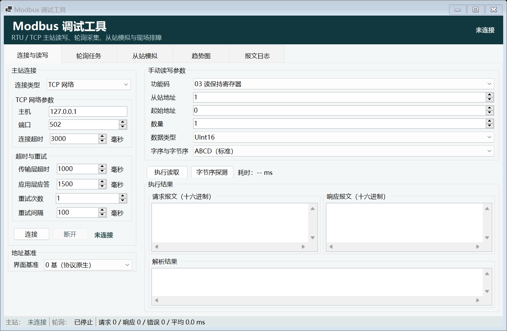
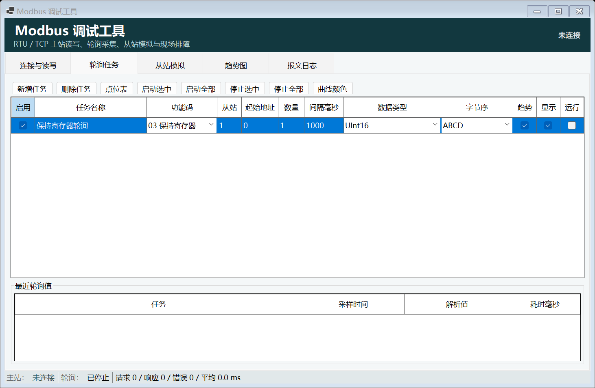
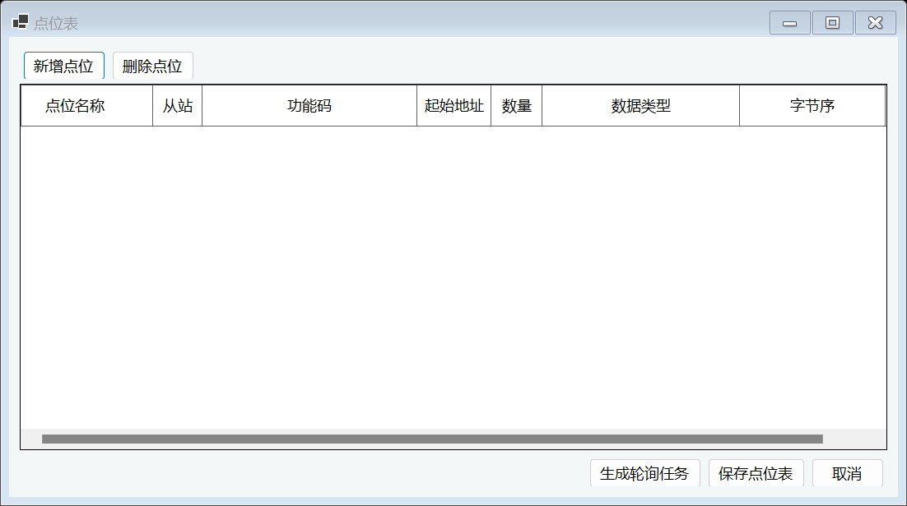
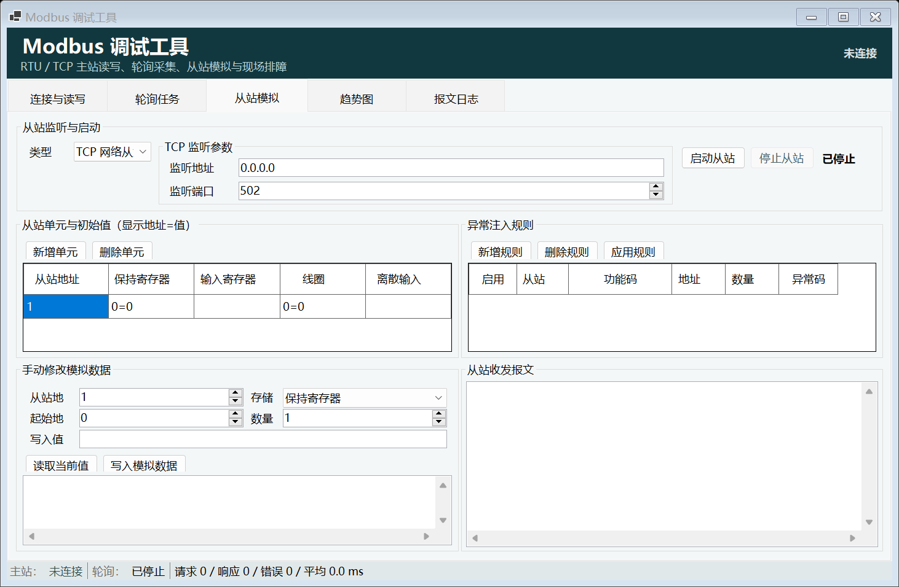
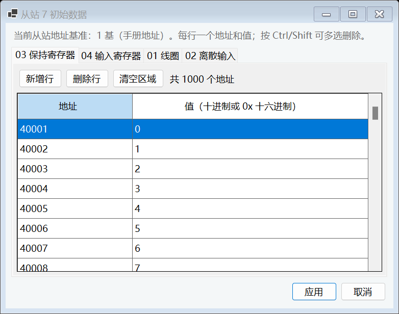
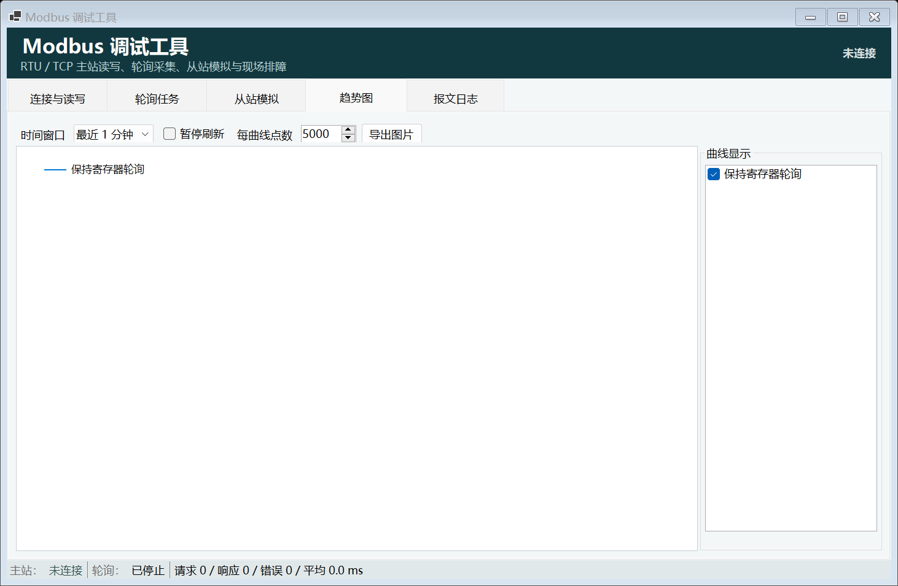
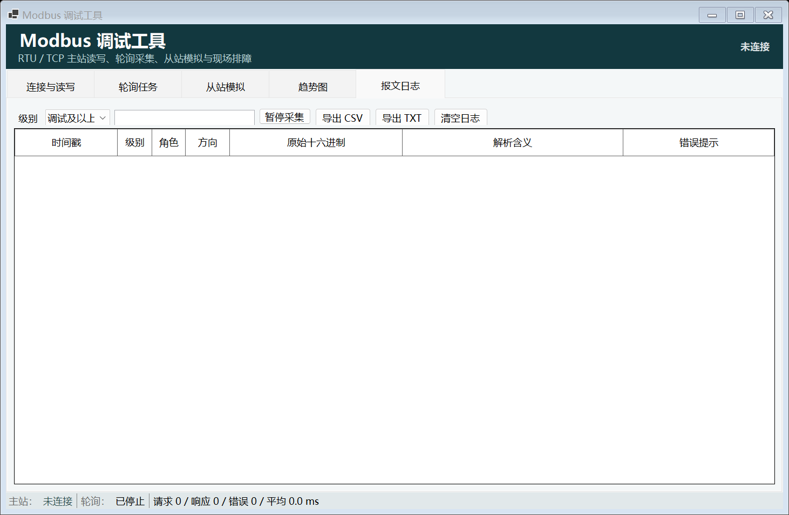
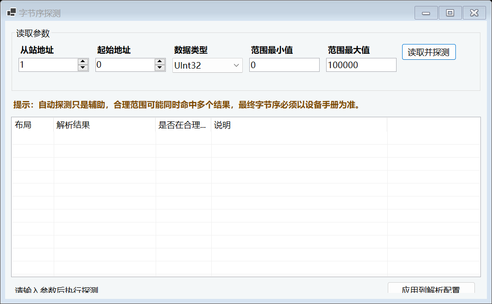

# Modbus 调试工具软件使用手册

## 1. 手册范围

本手册适用于 ModbusHelper 的 WinForms 版本，覆盖以下现场工作：

- Modbus RTU 和 Modbus TCP 主站连接。
- 手动读写线圈、离散输入、保持寄存器和输入寄存器。
- 多任务周期轮询、数据解析和趋势观察。
- RTU/TCP 从站模拟，以及多个 UnitID 的独立数据区。
- 报文日志、异常注入、通信统计和日志导出。
- 字节序辅助探测和解析配置应用。

工具不会因为加载配置而自动连接、启动轮询或启动从站。启动后请先确认连接参数，再执行通信操作。

## 2. 启动和配置文件

### 2.1 直接运行已编译程序

Release 程序位于：

```text
src/ModbusHelper.WinForms/bin/Release/net8.0-windows/ModbusHelper.WinForms.exe
```

### 2.2 从源码编译

在仓库根目录执行：

```powershell
dotnet restore ModbusHelper.sln
dotnet build ModbusHelper.sln --configuration Release
dotnet run --project src/ModbusHelper.WinForms/ModbusHelper.WinForms.csproj
```

### 2.3 配置文件

默认配置数据库与 EXE 位于同一目录：

```text
ModbusHelper.db
```

数据库保存串口和 TCP 参数、轮询任务、点位表、地址基准、数据解析设置、趋势容量和从站模拟配置。旧版 `%LocalAppData%\ModbusHelper\config.json` 会在首次启动时自动迁移。连接状态、轮询运行状态、实时趋势点、统计计数和内存日志不保存；日志可从“报文日志”页导出。程序启动后不会自动连接或启动轮询。EXE 所在目录需要有写入权限；只读安装目录会导致配置无法保存。

主窗口顶部提供“悬停提示”和“窗口置顶”两个会话级开关。“悬停提示”关闭后，主窗口控件和趋势图不再显示 Tip，但不影响通信；“窗口置顶”控制主窗口是否保持在其他窗口上方。两个设置只对当前运行实例生效。

## 3. 主界面概览



图 1：主站连接与读写页。左侧管理主站连接和超时，右侧用于一次性手动读写，底部显示请求、响应和解析结果。

主界面包含五个页签：

| 页签 | 用途 |
| --- | --- |
| 主站连接与读写 | 连接主站、设置地址基准、执行单次读写和查看报文 |
| 轮询任务 | 配置多条周期任务、批量启停和生成趋势数据 |
| 从站模拟 | 启动 RTU/TCP 从站、配置 UnitID、初始数据和异常规则 |
| 趋势图 | 查看轮询点位的实时曲线并导出 PNG |
| 报文日志 | 查看、过滤、搜索和导出 Master/Slave 报文日志 |

将鼠标停在控件上可以查看 Tip。提示重点解释地址换算、两层超时、字节序、多选操作和异常注入等容易误解的设置。

## 4. 连接真实设备

### 4.1 Modbus RTU

1. 打开“主站连接与读写”。
2. “连接类型”选择“RTU 串口”。
3. 选择串口，设置波特率、数据位、校验位和停止位。
4. 设置“传输层超时”和“应用层应答超时”。
5. 按需要设置重试次数和重试间隔。
6. 点击“连接”，状态变为“已连接”后执行读写。

RTU 两端的串口参数必须一致。Modbus RTU 通常使用 `8` 个数据位，主从自环建议使用 `9600-8-N-1`。
如果一端为 5 位、另一端为 8 位，字节可能被截断并表现为 CRC 错误。串口被其他软件占用时，
先关闭串口调试助手、PLC 编程软件或其他主站程序。

### 4.2 Modbus TCP

1. “连接类型”选择“TCP 网络”。
2. 输入设备 IP 地址或主机名。
3. 输入设备监听端口，标准 Modbus TCP 端口通常为 `502`。
4. 设置 TCP 建立连接超时、传输层超时和应用层应答超时。
5. 点击“连接”。

TCP 的 UnitID 仍然需要按设备要求填写。普通 TCP 设备通常使用 `1`，网关设备可能使用其他 UnitID。

### 4.3 两层超时的区别与计算

- 传输层超时：限制串口或 TCP 底层读写操作。
- 应用层应答超时：限制发送请求后等待完整 Modbus 响应帧的时间。

一次请求按“发送、等待、失败后重试”的顺序执行。重试次数为 `N` 时，理论等待预算约为：

`(N + 1) × 传输层超时 + N × 重试间隔`

例如传输层超时 1000 毫秒、重试次数 3、重试间隔 100 毫秒，理论预算约为 4300 毫秒。
如果应用层应答超时只有 1500 毫秒，程序可能还没有完成全部重试就先报应用层应答超时。
设备提前响应会立即结束等待；只有设备不响应、参数错误、线路异常或设备处理过慢时才会走到超时。

设备响应慢时，应优先增加应用层应答超时；串口通信本身不稳定时，再检查传输层超时和重试参数。

## 5. 地址基准和手动读写

### 5.1 地址基准

“地址基准”只影响界面显示和用户输入，发送给 NModbus 的地址始终是 0 基协议地址。

| 界面基准 | 示例 | 发送给 NModbus |
| --- | --- | --- |
| 0 基 | `0` | `0` |
| 1 基 | `1` 或设备手册中的 `40001` 风格地址 | 转换为 `0` |

切换基准后，轮询表和点位表中的地址显示会同步换算。不要在已经是 0 基的地址上再次手动减一。

### 5.2 功能码

工具支持：

| 功能码 | 含义 | 读写 |
| --- | --- | --- |
| `01` | 读线圈 | 读 |
| `02` | 读离散输入 | 读 |
| `03` | 读保持寄存器 | 读 |
| `04` | 读输入寄存器 | 读 |
| `05` | 写单线圈 | 写 |
| `06` | 写单寄存器 | 写 |
| `0F` | 写多线圈 | 写 |
| `10` | 写多寄存器 | 写 |

读操作的 UnitID 只能为 `1-247`。写操作允许 `0` 作为广播地址，也允许 `1-247` 的普通地址。`248-255` 会根据 RTU/TCP 模式给出警告。

### 5.3 手动读写步骤

1. 选择功能码。
2. 输入 UnitID、起始地址和数量。
3. 读寄存器时选择数据类型和字节序。
4. 写操作时在“写入数据”输入值，多个值可以使用逗号、分号或空格分隔。
5. 点击“执行读取”或“执行写入”。
6. 查看请求历史和响应历史（各保留最近 200 条，格式为“【时间戳】十六进制报文”）、耗时、
   原始寄存器和当前操作的解析结果；完整通信记录请查看“报文日志”页。
   历史区域原本在底部时会自动跟随新记录；手动滚到旧记录后不会被新数据强行拉回。
   新记录追加在末尾，不会主动横向滚动，也不会取消你选中的文字。
   超出 200 条时删除最旧记录；正在查看的记录只要仍在保留范围内，就继续停留在该处。

数量限制如下：

- 寄存器读取：`1-125`。
- 线圈或离散输入读取：`1-2000`。
- 多线圈和多寄存器写入遵守 Modbus 协议上限。

## 6. 数据类型和字节序

每个 Modbus 寄存器是一个 16 位 `ushort`，也就是 2 个字节。线圈和离散输入不是寄存器，
而是单个位，响应报文中会按字节打包。数据类型转换规则如下：

| 数据类型 | 所需寄存器 |
| --- | --- |
| Int16、UInt16 | 1 个 |
| Int32、UInt32、Float | 2 个 |
| Double | 4 个 |
| ASCII、UTF-8 字符串 | 按连续寄存器拼接字节 |

当前轮询、点位表和手动读取一次只生成一个解析值。为了避免“读取了多个寄存器却只解析第一个寄存器”的歧义，
03/04 读取选择固定数值类型时，界面会自动限制数量：`Int16/UInt16` 为 1，`Int32/UInt32/Float` 为 2，
`Double` 为 4。选择 ASCII 或 UTF-8 字符串时，数量可以按需要读取多个寄存器；01/02 的数量仍按线圈或离散输入的位数计算。
写多寄存器不受这个解析限制，写入数量由“写入数据”中的值个数决定。

工具统一使用以下术语：

- 字序：多个 16 位寄存器之间的排列顺序。
- 字节序：单个 16 位寄存器内部高低字节的排列顺序。

四种布局如下：

| 布局 | 说明 |
| --- | --- |
| ABCD | Reg0 高字节、Reg0 低字节、Reg1 高字节、Reg1 低字节 |
| CDAB | 交换寄存器顺序，寄存器内部仍为高字节在前 |
| BADC | 寄存器顺序不变，每个寄存器内部低字节在前 |
| DCBA | 交换寄存器顺序，并反转每个寄存器内部字节 |

如果设备手册没有明确说明，先使用字节序探测工具辅助判断，再以设备手册为最终依据。

## 7. 轮询任务



图 2：轮询任务页。任务表支持编辑功能码、地址、数量、间隔、数据类型、字节序和“趋势”采集选项。

### 7.1 新增和配置任务

1. 点击“新增任务”。
2. 设置任务名称、读取功能码（01、02、03 或 04）、UnitID、起始地址、数量和间隔。
3. 选择数据类型和字节序。
4. 勾选“启用”。
5. 如需趋势图，勾选“趋势”。
6. 打开“趋势图”页，在右侧“曲线显示”中勾选需要绘制的曲线。

轮询间隔最小为 `100` 毫秒。同一个主站连接下的任务会串行排队，避免并发访问同一个 NModbus Master。不同串口或不同 TCP 连接可以并行运行。
任务表在 03/04 选择固定数值类型后会立即更新数量，避免保存出不匹配的配置；字符串类型可以保留可变数量。
固定数值类型的“数量”单元格不可编辑；若加载到旧的非法配置，进入该单元格时会自动恢复为正确数量。
“最近轮询值”按任务保留一行，数量表示一次请求覆盖的连续元素数量，不会拆成多行；
趋势图也按任务保留一条曲线、每次轮询追加一个解析值。需要分别观察多个地址时，应分别建立多个任务。

### 7.2 多选和批量操作

- 按住 `Ctrl` 点击多行，可以选择不连续任务。
- 按住 `Shift` 点击，可以选择连续任务。
- “启动选中”“停止选中”“删除任务”会对全部选中行执行。
- “启动全部”只启动已启用的任务。
- 停用一条任务不会影响其他任务。

### 7.3 点位表



图 3：点位表。适合保存常用设备点位，并将选中点位生成轮询任务。

点击“点位表”后可以：

1. 新增点位，或通过 `Ctrl` / `Shift` 多选后批量删除。
2. 设置点位名称、读取功能码（01 至 04）、UnitID、地址、数量、数据类型和字节序。
3. 勾选是否加入趋势图。
4. 点击“保存点位表”后，点位配置立即写入 EXE 同目录的 SQLite 数据库。
5. 选中点位后点击“生成轮询任务”快速创建任务。

## 8. 从站模拟器



图 4：从站模拟页。上方选择 RTU/TCP 监听方式，中间配置多个 UnitID，下面可以手动修改模拟数据并查看报文。



图 5：从站初始数据明细。四个存储区分别按地址列出，可用 Ctrl/Shift 多选后删除。

### 8.1 TCP 从站联调

1. 打开“从站模拟”。
2. 类型选择“TCP 网络从站”。
3. 设置监听地址，例如 `127.0.0.1` 或 `0.0.0.0`。
4. 设置未被占用的监听端口。
5. 在“模拟设备与初始数据（启动时加载）”表中配置从站地址（UnitID）和初始数据。列名中的 `01`、`02`、`03`、`04`
   分别表示线圈、离散输入、保持寄存器、输入寄存器读取功能码。主表显示各存储区的摘要，
   不再把所有地址和值挤在同一个单元格；选中从站后点击“编辑初始数据”，或双击对应存储区单元格，
   在明细窗口中按“一行一个地址和值”查看和编辑。明细窗口支持新增、删除、清空和应用。
   可按 Ctrl 或 Shift 多选多行后删除；地址跟随从站地址基准。寄存器值支持十进制和 `0x` 十六进制，
   线圈/离散输入值支持 `ON/OFF`、`1/0`。重复地址或不合法数据会阻止应用并定位到出错单元格。
6. 点击“启动从站”。
7. 回到“主站连接与读写”，用相同 IP、端口和 UnitID 连接主站。

同一个从站网络可以挂载多个不同 UnitID，每个 UnitID 的线圈、离散输入、保持寄存器和输入寄存器互相独立。
主表适合比较多个从站，明细窗口适合维护某一个从站的大量地址数据。
同一个监听端口内每个从站地址（UnitID）只能出现一次；重复地址无法区分请求应由哪个从站单元响应，
编辑时会直接拦截，启动前也会再次校验。

### 8.2 RTU 从站联调

使用 com0com 创建成对虚拟串口时，例如使用 `COM1` 和 `COM2`：

1. 从站选择“RTU 串口从站”，绑定 `COM2`。
2. 主站选择“RTU 串口”，连接 `COM1`。
3. 两端使用相同的 `9600-8N1` 参数。
4. 从站启动后，再连接主站。

RTU 帧间静默和帧完整性由 NModbus 传输层处理，业务层不自行读取或分割串口字节流。

### 8.3 手动修改模拟数据

1. 输入从站地址（即主站请求中的 UnitID）、存储区域、起始地址和数量。
2. 读取当前值，确认模拟数据。
3. 在“写入值”输入新值。
4. 点击“写入模拟数据”。
5. 主站再次读取即可观察变化。
6. 下方结果区按“【时间戳】信息”保留最近 100 条读取、写入和错误记录；
   只有滚动条原本在底部时才会自动跟随新记录；如果用户正在查看旧记录，
   刷新后会恢复原来的顶部可见行，不会跳到最上方。

如果只模拟固定数据，只用上方初始数据表即可。初始数据表用于设置从站启动时的内存；
修改表格不会改变正在运行的内存，停止并重新启动后才会加载新值。配置关闭程序时保存。

“手动修改模拟数据”是可选的运行时操作，用于不重启从站而临时改变当前内存，
例如模拟传感器值从 `100` 变化为 `125`。写入后主站下一次读取立即得到 `125`；
停止从站后临时修改会丢失，下一次启动恢复为初始数据表中的值。

## 9. 异常注入

在“异常注入规则”中新增规则，设置：

- 是否启用。
- UnitID。
- 功能码。
- 起始地址。
- 连续地址数。
- 异常码。

“启用”勾选后该规则才参与匹配；取消勾选只保存规则，不触发异常。
从站运行中新增、修改或启用/停用规则后，都要点击“应用规则”才会更新当前规则；
只勾选“启用”但不应用，运行中的规则不会改变。未启动从站时，启动会读取当前规则。
例如起始地址 `40001`、连续地址数 `1` 只覆盖 `40001`。
只有主站请求的 UnitID、功能码相同，且请求地址范围与规则范围有交集时，才返回指定异常码；
因此读取 `40002` 不会命中这条规则。

常用异常码：

| 异常码 | 中文含义 |
| --- | --- |
| `01` | 非法功能 |
| `02` | 非法数据地址 |
| `03` | 非法数据值 |
| `04` | 从站设备故障 |
| `05` | 从站已接收请求，正在处理，需要后续轮询读取结果 |
| `06` | 从站忙 |
| `08` | 存储奇偶性差错 |
| `0A` | 网关路径不可用 |
| `0B` | 网关目标设备无响应 |

## 10. 趋势图



图 6：趋势图页。左侧绘制曲线，右侧控制每条曲线的显示状态。

1. 在轮询任务中勾选“趋势”。
2. 使用“曲线颜色”设置任务颜色。
3. 打开“趋势图”页，选择最近 1 分钟、5 分钟或 30 分钟。
4. 在趋势页右侧“曲线显示”中独立显示或隐藏每条已经加入趋势的曲线。
5. 使用“暂停刷新”暂时停止界面刷新。
6. 调整“每曲线点数”，默认容量为 5000。
7. 点击“导出图片”保存当前图表为 PNG。

“趋势”决定是否将轮询结果写入趋势缓冲区；“曲线显示”只决定已经采集的曲线是否绘制。
暂停刷新只暂停 UI 绘图，后台轮询仍可继续采样。环形缓冲区超过容量后覆盖最旧点，不会无限增长。
趋势图使用单一的数据点提示，点集合按批次更新，并限制鼠标命中检测频率，减少大量采样点下的界面卡顿。

## 11. 报文日志



图 7：报文日志页。日志区分 Master/Slave 角色和 TX/RX 方向，便于同时开启主站和从站模拟时排障。

日志字段包括：

- 时间戳，精确到毫秒。
- 界面显示为【时间戳】格式；日志表默认最新记录在顶部，滚到旧记录后刷新会保留当前查看位置。
- 日志级别。
- Role：`Master` 或 `Slave`。
- 方向：`TX` 或 `RX`。
- 原始十六进制报文。
- 解析含义。
- 错误提示。

使用“级别”过滤日志，用搜索框按报文、解析含义或错误提示检索。点击“暂停采集”只暂停新增日志，历史记录仍保留。

CSV 和 TXT 导出均使用 UTF-8 with BOM。CSV 按 RFC 4180 规则转义，Excel 打开中文不会乱码。

## 12. 字节序探测



图 8：字节序探测窗口。工具读取同一组原始寄存器，并列出四种布局的解析结果。

1. 主站连接成功后打开“字节序探测”。
2. 输入 UnitID 和起始地址。
3. 选择 Int32、UInt32、Float 或 Double。
4. 输入合理范围的最小值和最大值。
5. 点击“读取并探测”。
6. 查看 ABCD、CDAB、BADC、DCBA 四种结果。
7. 选中需要的布局，点击“应用到解析配置”。

落在合理范围内的结果会高亮。合理范围过宽时可能同时命中多个结果，推荐结果只能作为辅助判断。

## 13. 常见问题排查

### 13.1 连接失败或超时

1. RTU 检查串口是否被占用，以及两端串口参数是否一致。
2. TCP 检查 IP、端口和防火墙。
3. 区分传输层超时与应用层应答超时。
4. 检查 UnitID 是否正确。
5. 查看报文日志中的 TX/RX 是否完整。

### 13.2 异常码 02

检查地址基准、起始地址、数量、功能码和设备实际存储区。特别注意设备手册中的 `40001` 风格地址需要选择正确的 1 基显示。

### 13.3 异常码 05

这表示从站已接收请求，正在处理，需要后续轮询读取结果，不应当直接当作普通失败。

### 13.4 CRC 错误或报文不完整

先检查主站、从站和设备的数据位是否一致，尤其不要把 Modbus RTU 一端设置为 5 位而另一端设置为 8 位；
然后检查波特率、校验位、停止位、线路屏蔽接地、终端电阻和串口转换器。RTU 帧分隔由 NModbus 传输层处理，
业务层不应按固定长度或按行读取。

### 13.5 关闭后串口无法重新打开

先确认没有其他程序占用串口。正常关闭窗体或断开连接时，程序会停止轮询、停止从站并释放 SerialPort、Socket 和 Master。

### 13.6 多开、窗口置顶和悬停提示

程序允许同时打开多个实例，没有单实例锁。不同实例应使用不同串口或不同 TCP 监听端口；
同一个串口或监听端口不能重复占用。多个实例默认使用同一目录下的 `ModbusHelper.db`，
同时修改配置时以后保存的实例可能覆盖先保存的配置。

主窗口顶部的“窗口置顶”只影响当前实例的窗口层级；“悬停提示”只控制当前主窗口内的控件和趋势图提示。

## 14. 自环验收

使用虚拟串口 `COM1` 和 `COM2`：

```powershell
dotnet run --project tests/ModbusHelper.Verification/ModbusHelper.Verification.csproj -- --rtu COM1 COM2
dotnet run --project tests/ModbusHelper.UiSmoke/ModbusHelper.UiSmoke.csproj -- --rtu COM1 COM2
```

第一个串口参数为主站串口，第二个串口参数为从站串口。验收完成后，UI 截图会生成在：

```text
tests/ModbusHelper.UiSmoke/bin/Debug/net8.0-windows/ui-smoke/
```

## 15. 相关文档

- [快速使用说明](使用说明.md)
- [架构说明](架构说明.md)
- [任务拆分](任务拆分.md)
- [当前交接简报](handoff.md)
- [长期事实库](facts.md)
